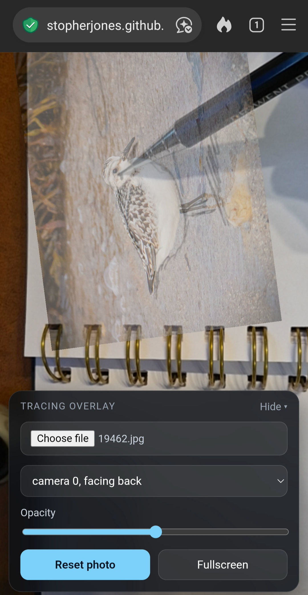

# AR Tracing Overlay

A simple browser-based tracing aid. It shows your camera feed full screen and places a photo on top as a semi-transparent overlay, so you can trace the image onto paper or a surface.

**Live demo:** https://stopherjones.github.io/AR-drawing/




No libraries, no build step, no install. It's a single HTML file.

## Features

- **Live camera view** with the camera feed kept fixed behind the overlay
- **Camera selection**, with front-facing cameras hidden where the browser labels them
- **Load any photo** from your device
- **Drag to move**, **pinch or scroll to zoom**, and **twist or shift-drag to rotate** the photo
- **Opacity slider** to balance the photo against what's under it
- **Reset** to return the photo to its starting position, scale, and rotation
- **Fullscreen button** to hide the browser's toolbars where the browser allows it
- **Collapsible control panel** so you can clear the view

## Usage

1. Open the page and allow camera access.
2. Tap **Choose file** and select a photo.
3. Adjust the photo with gestures and the opacity slider until it lines up with your paper.
4. Tap **Fullscreen** for a clearer view. Tap it again, or use your browser's back gesture, to exit.
5. Tap **Hide** to tuck away the controls. Tap the round **▴** button to bring them back.

### Gestures

| Action | Touch | Mouse |
| --- | --- | --- |
| Move photo | One-finger drag | Drag |
| Zoom | Pinch | Scroll wheel |
| Rotate | Two-finger twist | Shift + drag |

## Running it

Camera access requires a secure context, so the page must be served over HTTPS or from `localhost`.

**Option 1: GitHub Pages (recommended for phones)**
1. Push `index.html` to this repository.
2. Go to **Settings → Pages**, choose the `main` branch, and save.
3. Open the URL GitHub gives you on your phone.

**Option 2: Local**
```bash
python -m http.server 8000